# 🕹 Каталог игр для приставки «Эльф» (ALF TV Game)

В этом разделе собраны описания всех оригинальных игр, поставлявшихся во встроенном ПЗУ и на картриджах СКБ «ЗАПАД». Тексты описаний взяты из оригинальных игровых меню.

---

### 💾 Встроенные в ПЗУ приставки (27C010 — 128 КБ) — [📥 Скачать ПЗУ](original/Original_ROM_27c010.zip)

Стартовое меню приставки без встроенных игр (ПЗУ 27C256) и со встроенными играми (ПЗУ 27C010):

  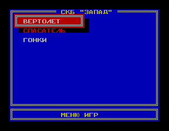
  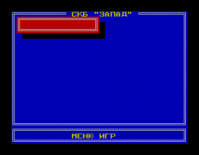

| Скриншоты | Название | Аналог ZX Spectrum | Описание (СКБ «ЗАПАД») |
| :---: | :--- | :--- | :--- |
| 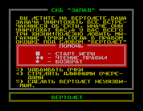 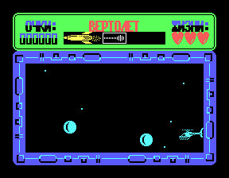 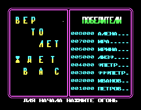 | **Вертолёт** | *Airwolf II* | Вы летите на вертолёте. Ваша задача уничтожать все встречающиеся объекты, иначе они уничтожат вас, а у вас всего три жизни! Ловите мигающие точки для получения возможностей: 1) одним ударом уничтожить всех врагов на экране, 2) увеличить скорость, 3) удваивать очки, 4) стрелять длинными очередями, 5) сделать вертолёт неуязвимым. Выбор — кнопкой «Огонь» на джойстике 2. |
| 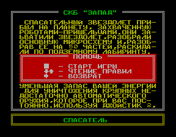 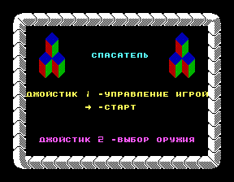 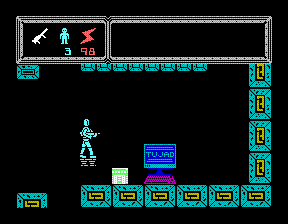 | **Спасатель** | *Tujad* | Спасательный звездолёт прибыл на планету, захваченную роботами-пришельцами. Они разобрали основную микросхему на 50 частей и раскидали по подземному лабиринту. Соберите микросхему, отбиваясь от роботов автоматическим оружием, гранатами и минами (смена оружия — джойстик 2). |
| 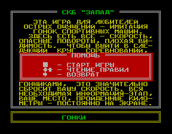 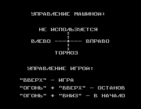 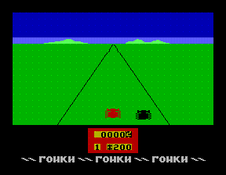 | **Гонки** | *Enduro* | Имитация гонок спортивных машин: скорость, опасные повороты, плохая видимость. Чтобы выйти в следующий круг соревнований, необходимо пройти трассу в течение определённого времени и попасть в лидирующую группу. |

---

### 📼 Картридж «Эльф-1» — [📥 Скачать архив (Alf-1_ROM.zip)](original/Alf-1_ROM.zip)

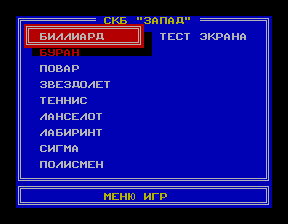

| Скриншоты | Название | Аналог ZX Spectrum | Описание (СКБ «ЗАПАД») |
| :---: | :--- | :--- | :--- |
| 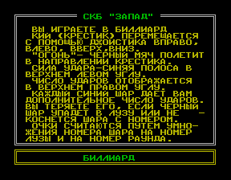 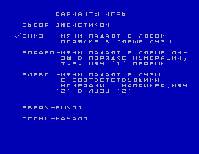 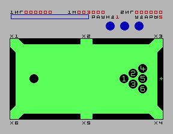 | **Биллиард** | *Video Pool* | Вы играете в биллиард. Крестик-прицел перемещается джойстиком в направлении удара, синяя полоса в верхнем левом углу регулирует силу удара. Синий шар даёт дополнительное число ударов. |
| 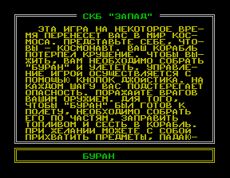 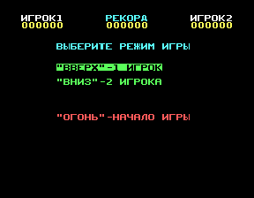 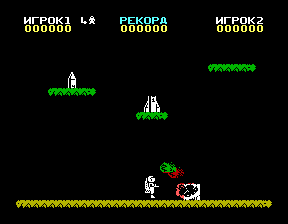 | **Буран** | *Jet Pac* | Ваш космический корабль потерпел крушение. Чтобы выжить, необходимо собрать «Буран» по частям, заправить топливом и сесть в корабль, поражая врагов оружием и собирая падающие предметы. |
| 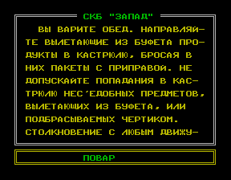 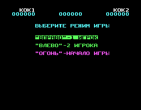 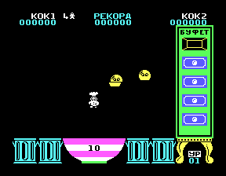 | **Повар** | *Cookie* | Вы варите обед. Направляйте вылетающие из буфета продукты в кастрюлю, бросая в них пакеты с приправой. Не допускайте попадания в кастрюлю несъедобных предметов. |
| 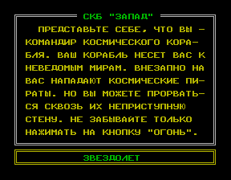 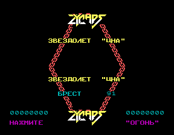 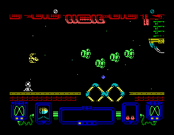 | **Звездолёт** | *Zynaps* | Вы — командир космического корабля. На пути к неведомым мирам на вас нападают космические пираты — прорвитесь сквозь их неприступную стену. |
| 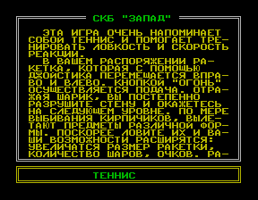 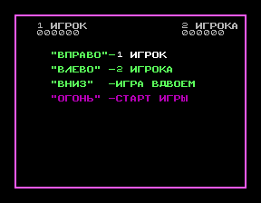 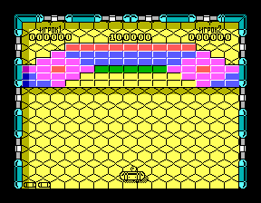 | **Теннис** | *Batty* | Игра напоминает теннис и помогает тренировать ловкость и скорость реакции. Разрушайте стену из кирпичиков и ловите падающие предметы, расширяющие ваши возможности. |
| 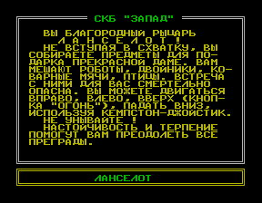 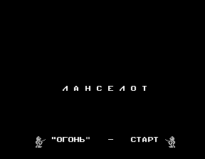 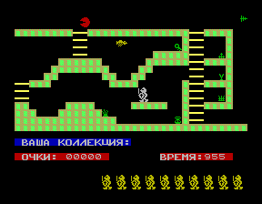 | **Ланселот** | *Sir Lancelot* | Вы — благородный рыцарь Ланселот. Не вступая в схватку, собирайте предметы для подарка прекрасной даме. Вам мешают роботы, двойники, коварные мячи и птицы. |
| 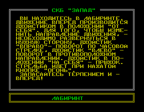 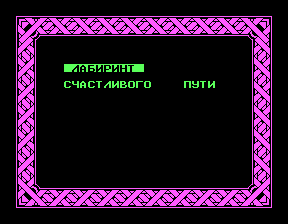 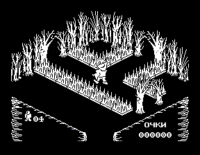 | **Лабиринт** | *Pentagram* | Вы находитесь в лабиринте. Движение вперёд — джойстик «От себя», повороты — «Вправо»/«Влево», прыжок — «На себя», стрельба — «Огонь». |
| 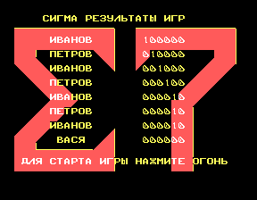 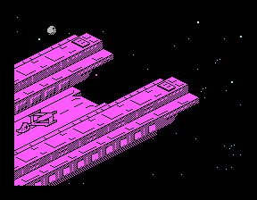 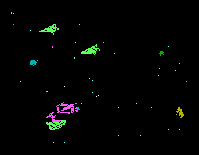 | **Сигма** | *Sigma 7* | Космическая аркада со сменой игровых этапов. |
| 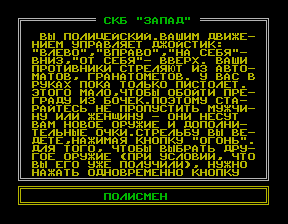 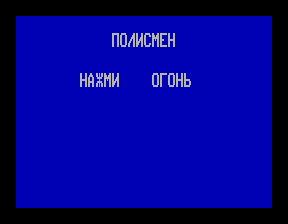 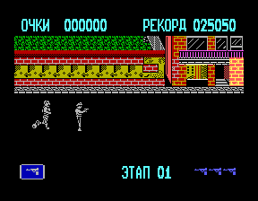 | **Полисмен** | *Jail Break* | Вы — полицейский, в руках пока только пистолет. Уничтожайте преступников и освобождайте заложников, чтобы получить более мощное оружие. |
| 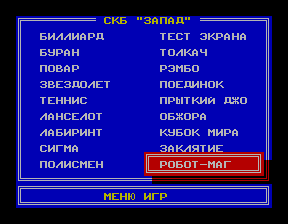 | **Тест экрана** | — | Тестовая таблица цветных полос. |

---

### 📼 Картридж «Эльф-2» — [📥 Скачать архив (Alf-2_ROM.zip)](original/Alf-2_ROM.zip)

Меню стандартного картриджа «Эльф-2» (4 игры) и второго варианта картриджа (с добавлением 3 игр из встроенного ПЗУ, [скачать Alf-2_1_ROM.zip](original/Alf-2_1_ROM.zip)):

  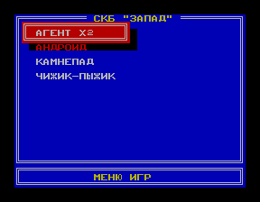
  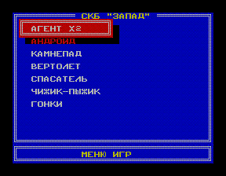

| Скриншоты | Название | Аналог ZX Spectrum | Описание (СКБ «ЗАПАД») |
| :---: | :--- | :--- | :--- |
| 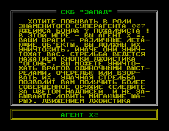 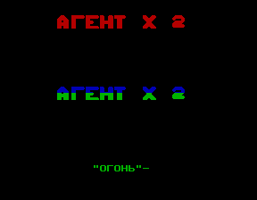 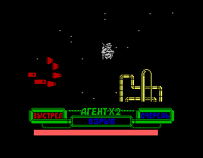 | **Агент Х2** | *Agent X II* | Вы в роли суперагента Агента Х2. Уничтожайте летающие объекты одиночными выстрелами, очередью или взрывами и ловите мигающие шары для получения более совершенного оружия. |
| 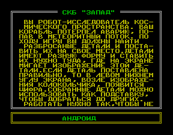 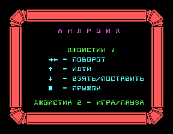 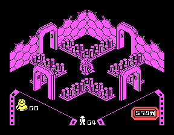 | **Андроид** | *Alien 8* | Вы — робот-исследователь космического пространства. Корабль потерпел аварию, попав в метеоритный поток. Найдите разбросанные детали и поставьте их на свои места. |
| 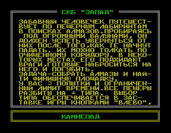 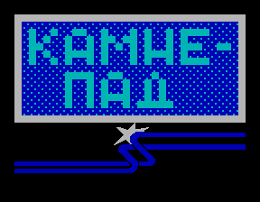  | **Камнепад** | *Boulder Dash* | Забавный человечек путешествует по пещерным лабиринтам в поисках алмазов. Уворачивайтесь от падающих валунов и врагов, соберите алмазы и найдите финишную площадку. |
|    | **Чижик-Пыжик** | *Nifty-Lifty* | Маленький человечек бегает по направлению стрелок и собирает игрушки. По вертикали постоянно перемещаются препятствия, с которыми нельзя столкнуться. |

---

### 📼 Картридж «Эльф-3» — [📥 Скачать архив (Alf-3_ROM.zip)](original/Alf-3_ROM.zip)

| Скриншоты | Название | Аналог ZX Spectrum | Описание (СКБ «ЗАПАД») |
| :---: | :--- | :--- | :--- |
|    | **Моторалли** | *Enduro Racer* | Мотогонки со скоростью и опасными поворотами. Управление: ускорение — джойстик вперёд, сброс скорости — назад, повороты — влево/вправо. |
|    | **Коля сапёр** | *Bomb Jack* | Вы — сапёр, задача — обезвредить как можно больше бомб, избегая движущихся человечков, объектов и птиц. Три типа витаминов: P — парализует врагов, E — даёт попытку, B — увеличивает счёт. |
|    | **Робин в лесу** | *Robin of the Wood* | Вы оказались в лесу, где на вас нападают враги. Соберите три цветочка, встретьте прекрасную даму и прорвитесь к замку, опасаясь диких кабанов. |
|    | **Киберноид** | *Cybernoid* | Вы управляете роботом, вооружённым пулемётом и бомбами. Собирайте предметы на пути, чтобы получить новое оружие или увеличить запас бомб. |
|    | **Игра на льду** | *Xeno* | Ледовое сражение с компьютером или вторым игроком. Направление движения выбирается джойстиком, старт — кнопкой «Огонь». |
|    | **Барбариан** | *Barbarian* | Боевой поединок на мечах с искусным соперником. Удары мечом, ногой, вращения, приседания и перекаты выполняются комбинациями джойстика и кнопки «Огонь». |

---

### 📼 Картридж «Эльф-4» — [📥 Скачать архив (Alf-4_ROM.zip)](original/Alf-4_ROM.zip)

| Скриншоты | Название | Аналог ZX Spectrum | Описание (СКБ «ЗАПАД») |
| :---: | :--- | :--- | :--- |
|    | **Толкач** | — | Вы должны сталкивать яйцевидный предмет на головы врагов (старт игры — движением джойстика «Вниз»). |
|    | **Рэмбо** | — | Вы — герой фильма «Рэмбо-2», выполняете задание в Индокитае. Задача: собрать оружие, прорваться в военный городок, освободить пленника, найти вертолёт, выпустить пленных из сарая и уничтожить ангар главнокомандующего. |
|    | **Поединок** | — | Восточные единоборства с богатым арсеналом приёмов: сальто, прыжки, верхний блок и удары палкой и ногой. |
|    | **Прыткий Джо** | *Jumping Jack* | В роли «Прыткого Джо» доберитесь до верха экрана через движущиеся отверстия, избегая встреч с препятствиями. |
|    | **Обжора** | — | Вы — ненасытный пожиратель овощей и фруктов в охраняемом огороде-лабиринте. Приняв допинг в виде колокольчика, можно съесть охранника. |
|    | **Кубок мира** | *World Cup Football* | Борьба за Кубок мира по футболу: режим «Матч» для игры вдвоём с другом и чемпионат «Кубок мира» против телеигры «Эльф». |
|    | **Заклятие** | *Sabre Wulf* | Освобождение путешественника Сабре Вульфа от заклятия, превращающего его ночью в вурдалака. Нужно за 40 дней найти составные части волшебного зелья для мага Мельхиора. |
|    | **Робот-маг** | — | Далёкое космическое путешествие робота-мага. Цель — собрать разбросанные по вселенной компоненты «Центурион», заряжающие энергией и дающие более мощное оружие. |

---

### 📼 Картридж «Эльф-5» — [📥 Скачать архив (Alf-5_ROM.zip)](original/Alf-5_ROM.zip)

| Скриншоты | Название | Аналог ZX Spectrum | Описание (СКБ «ЗАПАД») |
| :---: | :--- | :--- | :--- |
|    | **Луноход** | — | Вы командир лунохода. Планету оккупировали пришельцы и установили на атомной станции взрыватель. За 10 часов надо долететь до станции и уничтожить взрыватель, опасаясь червей в норах. |
|    | **Циклон** | — | Управляя вертолётом, спасите людей с островов Атлантического океана при ограниченном времени и бензине, держась подальше от циклона. |
|    | **Беглец** | — | Человечку нужно собрать все ящики и перейти на следующий уровень, выкапывая ямки кнопкой «Огонь» против преследующих врагов. |
|    | **Подземелье** | — | Приключения утёнка в пещерах подземелья, встречи с ведьмами, монстрами, привидениями, гномами и мишками. |
|    | **Диззи** | *Dizzy* | Злой колдун Закс напал на город Катманду. Цель отважного человечка Диззи — выяснить рецепт зелья, сварить его, найти в замке колдуна и погубить его. |
|    | **Бросок** | — | Игра напоминает теннис: надо отражать мяч, стараясь выбить им все квадратики (всего 100 уровней, попадание в квадратики с буквами меняет размер ракетки и даёт бонусы). |

---

### 📼 Картридж «Эльф-6» — [📥 Скачать архив (Alf-6_ROM.zip)](original/Alf-6_ROM.zip)

| Скриншоты | Название | Аналог ZX Spectrum | Описание (СКБ «ЗАПАД») |
| :---: | :--- | :--- | :--- |
|    | **Город пауков** | — | Спасение детей из окружённого высокими стенами города. |
|    | **Диззи-2** | *Dizzy 2* | Коварные пираты спрятали на острове награбленные ценности. Задача Диззи — помочь двум братьям-близнецам, доставив предметы первому брату и собрав 30 монет для второго. |
|    | **Муравей** | — | Вам предстоит управлять муравьём, который бегает по лабиринтам, собирая мигающие объекты или перекрашивая коридор, и укрывается от врагов за сдвижными стенками. |
|    | **Смелый дог** | — | Злой колдун заточил 4 членов семьи в стеклянные колбы в старом замке с призраками. Смелый дог бегает по этажам замка и расправляется с нечистой силой. |
|    | **СУ-27** | — | Вы — лётчик-истребитель («Су-27 Боевой сокол»). Выполняйте боевые задания в Сахаре, саванне, на Севере и в океане, уничтожая истребители, вертолёты и ПВО противника. |
|    | **Крепость** | — | Герой, вооружённый только винтовкой, оказывается в 8-этажном доме, полном штурмовиков. Надо найти антикварную коллекцию, открывая железные двери ключами. |

---

### 📼 Картридж «Эльф-7» — [📥 Скачать архив (Alf-7_ROM.zip)](original/Alf-7_ROM.zip)

| Скриншоты | Название | Аналог ZX Spectrum | Описание (СКБ «ЗАПАД») |
| :---: | :--- | :--- | :--- |
|    | **Штурм башни** | — | Станьте покорителем сказочных башен («Замок дракона», «Царство роботов», «Ловушка», «Лабиринт», «Скользкая гора», «Водный замок», «Западня», «Злой рок»), находя подъёмники и опасаясь пропастей и летающего дракона. |
|    | **Солдат удачи** | *Soldier of Fortune* | В лабиринте пещер нужно собрать части таинственного письма, отбиваясь от ловушек, чудовищ и драконов и собирая дротики, ключи и мечи. |
|    | **Бармен** | *Tapper* | Попробуйте поработать барменом в популярном заведении: обслуживайте посетителей, вводя инициалы джойстиком перед началом игры. |
|   | **Шахматы** | — | Шахматы в диалоговом режиме с компьютером, с выбором уровня сложности, цвета фигур и установкой начальной позиции на доске. |
|    | **Покер** | — | Автомат для игры в видеопокер (сдаётся 5 карт, комбинации: пара, тройка, стрит, флеш, фул, каре, стрит-флеш, флеш-рояль). |
|    | **Маневры** | *Raid over Moscow* | Военные учения в 4 этапа: 1) вылет самолётов из ангара, 2) бомбардировка баз врага над лесом, 3) уничтожение башен, 4) захват крепости. |
|    | **Авторалли** | — | Имитация автогонки на время с выбором марки автомобиля. Следите за деревьями, километровыми столбами и камнями во избежание столкновений и заносов. |
|    | **Гонщик-лихач** | — | Проедьте через точки и соберите кубки по пути из одного города Америки в другой, используя приборы и радар для ухода от чёрных и голубых автомобилей. |

---

### 📼 Картридж «Эльф-8» — [📥 Скачать архив (Alf-8_ROM.zip)](original/Alf-8_ROM.zip)

| Скриншоты | Название | Аналог ZX Spectrum | Описание (СКБ «ЗАПАД») |
| :---: | :--- | :--- | :--- |
|    | **Разведчик** | — | Цель игры — проходя все зоны, уничтожать противника в военной форме, десантные автомобили и танки, собирать гранаты из красных ящиков и найти в конце «Красные ворота». |
|    | **После войны** | — | Вы попадаете на разрушенные улицы Нью-Йорка после войны в 1999 году. Работая локтями, кулаками и ногами, доберитесь до ближайшей станции метро с наименьшими потерями. |
|    | **Паук-убийца** | — | Героиня Рита попала в лабиринт с ядовитыми осами и пауками. Чтобы уничтожить насекомых, нужно найти баллончик с аэрозолью и баночку с пищей для пополнения сил. |
|    | **Танк** | — | Вы — командир танкового экипажа и должны провести танк через поля боя, собирая гранаты, супербомбы и дополнительные жизни (управление 2-м джойстиком). |
|    | **Теннис-2** | — | Смысл игры — пройти экран, разбивая блоки шаром и уничтожая лягушек и волчков шаром или ракеткой (даётся 3 шара). |
|    | **Стрелок** | — | Игра из 4 этапов на пути в город Кане: 1) охота с луком на птиц, 2–3) скачки на лошади, 4) стрельба по бандитам, захватившим город. |
|    | **Экспресс** | *Stop the express* | Экспресс «Италия» захватили гангстеры. Пробегите по крышам к 10-му вагону, спуститесь внутрь, пройдите в 1-й вагон за ключом и проникните в локомотив, чтобы остановить поезд. |

---

### 📼 Картридж «Эльф-9» — [📥 Скачать архив (Alf-9_ROM.zip)](original/Alf-9_ROM.zip)

| Скриншоты | Название | Аналог ZX Spectrum | Описание (СКБ «ЗАПАД») |
| :---: | :--- | :--- | :--- |
|    | **Диверсант** | *Saboteur* | Диверсанту поручено опасное задание: проникнуть в охраняемое здание, выполнить миссию и вовремя улететь на вертолёте с крыши. |
|    | **Вестбанк** | — | Ковбойский тир в банке: необходимо отстреливаться из-за прилавка от появляющихся бандитов. |
|    | **Шахтёр Вилли** | *Manic Miner* | Помогите нашему герою в его похождениях по подземным лабиринтам из 20 экранов. |
|    | **Пилот** | — | Воздушный бой: пилоту скоростного самолёта поручено охранять объект от вражеских истребителей, использующих супер-бомбы. |
|    | **Боец-33** | — | Эта игра для настоящих мужчин: побеждает тот, кто стреляет быстро и думает метко. |
|    | **Дан-Динамит** | — | Герой игры Дан-Динамит должен сорвать коварные планы доктора Блейзена и докторши Донны по захвату власти над всем миром. |
| — | **Истребитель** | — | *(Игра на эмуляторе работать отказалась, скриншоты отсутствуют)*. |

---

### 📼 Картридж «Эльф-10» — [📥 Скачать архив (Alf-10_ROM.zip)](original/Alf-10_ROM.zip)

| Скриншоты | Название | Аналог ZX Spectrum | Описание (СКБ «ЗАПАД») |
| :---: | :--- | :--- | :--- |
|    | **Мотогонки** | — | Имитация мотогонок. Преодолев рекорд, вы можете занести своё имя в таблицу лучших гонщиков. |
|    | **Снайпер** | — | В этой игре вам необходимо отыскать и застрелить бандитов, управляя джойстиком и ориентируясь по подсказкам-стрелкам в нижней части экрана. |
|    | **Робот-мутант** | — | На игру отводится 15 минут. Роботы (способные превращаться в автомобиль и летать) ведут борьбу с врагами и должны найти источник энергии. |
|    | **Колобок** | — | Отправляйтесь на раскопки! Помогите электронному колобку путешествовать в 5 пластах времени и собирать предметы при меняющейся обстановке. |
|    | **Колдунья** | *Cauldron* | Колдунья Орфидия однажды поругалась со своим соседом, и та лишила её метлы... *(на эмуляторе игра не работает)*. |
|    | **Томат-убийца** | — | Смиффи нанялся поработать. Ему необходимо отыскать в комнатах бутылку с маслом, преодолевая препятствия и спасаясь от нападающих на него овощей. |
|    | **Морской бой** | — | Ваша эскадра из 5 боевых кораблей «Кит» ведёт морской бой с подводными лодками противника, сбрасывая глубинные бомбы и получая подкрепление с вертолёта и батискафа. |

---

### 📼 Картридж-компиляция «Эльф 1-4» — [📥 Скачать архив (Alf1-4_ROM.zip)](original/Alf1-4_ROM.zip)

  
  

В картридже объёмом **1 МБ** присутствуют все игры из состава картриджей **1–4** и встроенного ПЗУ приставки.
